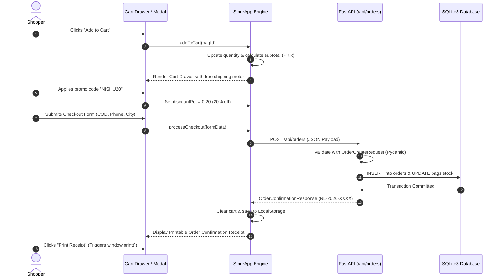

# 🏛️ System Architecture Document — NISHU LUXE

**System Name:** NISHU LUXE E-Commerce Engine  
**Architect:** Nitasha (Nishu)  
**Version:** 2.1.0  
**Stack:** Python FastAPI, SQLite3 (WAL Mode), Tailwind CSS, Vanilla JavaScript (ES6+)

---

## 1. High-Level Architecture Overview

NISHU LUXE is built as a **hybrid decoupled full-stack application**. It pairs an ultra-fast, zero-dependency Vanilla JavaScript frontend client with an asynchronous Python FastAPI REST backend, backed by an embedded SQLite3 relational database.

```mermaid
graph TD
    Client["Browser Client (HTML5 / Tailwind CSS / Vanilla JS)"]
    
    subgraph FrontendEngine ["Frontend Client Engine (frontend/js/app.js)"]
        StateMgr["StoreApp State Manager"]
        Cache["Browser LocalStorage (nishu_luxe_*_v2)"]
        DOM["Dynamic DOM Renderer"]
    end
    
    subgraph BackendAPI ["FastAPI Server (backend/main.py)"]
        Router["FastAPI REST Router (/api)"]
        StaticServe["StaticFiles Mount (/css, /js, /)"]
        CORS["CORS Middleware (*)"]
    end

    subgraph DatabaseLayer ["Database Engine (backend/database.py)"]
        SQLiteDB[("SQLite3 Database (nishuluxe_store.db)")]
        WAL["Write-Ahead Logging (WAL) PRAGMA"]
    end

    Client -->|User Interactions| StateMgr
    StateMgr -->|Persists State| Cache
    StateMgr -->|Renders UI| DOM
    StateMgr -->|HTTP Fetch (REST JSON)| Router
    Client -->|HTTP GET /| StaticServe
    Router -->|Thread-safe Transactions| SQLiteDB
    SQLiteDB --- WAL
```

---

## 2. Directory & Component Breakdown

```
School Project/
├── backend/
│   ├── database.py         # SQLite connection manager, tables DDL, seed data & queries
│   ├── main.py             # FastAPI app, CORS, routes, static file mounting
│   ├── models.py           # Pydantic v2 schemas for data contracts & validation
│   ├── requirements.txt    # Production dependencies: fastapi, uvicorn, pydantic
│   ├── nishuluxe_store.db  # Auto-generated SQLite database (WAL mode)
│   └── venv/               # Pre-configured Python virtual environment
└── frontend/
    ├── index.html          # Semantic HTML5 storefront, modals, cart drawer
    ├── css/
    │   └── custom.css      # Hover zoom, card lift, color swatches, @media print
    └── js/
        ├── app.js          # Unified single-source-of-truth client engine (StoreApp)
        ├── animations.js   # GSAP legacy visual transitions
        ├── cart.js         # Dedicated cart helper utilities
        └── catalog.js      # Raw catalog dataset reference
```

---

## 3. Client-Side Architecture (`frontend/js/app.js`)

The frontend is architected as an object-oriented, single-instance state machine encapsulated in the `StoreApp` class:

### 3.1 State Shape
```javascript
class StoreApp {
  constructor() {
    this.API_BASE = (window.location.port === '8000') ? window.location.origin : 'http://127.0.0.1:8000';
    this.products = [];             // Active 12+ bag inventory
    this.currentCategory = 'All';   // Category filter state
    this.currentSort = 'featured';  // Sorting state (featured, price-asc, price-desc, top-rated)
    this.searchQuery = '';          // Real-time keyword filter
    this.cart = [];                 // Array of OrderCartItems with quantities
    this.wishlist = new Set();      // Set of wishlisted bag IDs
    this.promoCode = '';            // Active applied promo code (e.g. NISHU20)
    this.discountPct = 0.0;         // Active discount multiplier (0.20 for 20%)
    this.selectedColors = {};       // Swatch state: { [bagId]: colorString }
  }
}
```

### 3.2 Dual-Hosting Compatibility Engine
The client automatically resolves its backend API endpoint depending on how it was launched:
1. **Served via FastAPI (`http://127.0.0.1:8000/`)**: `this.API_BASE` binds to `window.location.origin`. All requests are same-origin.
2. **Served via VS Code Live Server (`http://127.0.0.1:5500/`)**: `this.API_BASE` points to `http://127.0.0.1:8000`. Cross-Origin Resource Sharing (CORS) is enabled on FastAPI.
3. **Offline / Server Stopped**: If fetch fails or aborts (2-second timeout via `AbortController`), the application falls back immediately to client-side data and `localStorage` without displaying errors.

---

## 4. Client-Server Data Flow

### 4.1 Order Placement Lifecycle


---

## 5. Database Schema (SQLite3)

The database schema is defined in [`backend/database.py`](file:///c:/Users/DELL/OneDrive/Pictures/Desktop/School%20Project/backend/database.py). On application startup (`lifespan` handler), tables are created with `PRAGMA journal_mode = WAL` and auto-seeded if empty.

### 5.1 `bags` Table (Product Catalog)
```sql
CREATE TABLE IF NOT EXISTS bags (
    id TEXT PRIMARY KEY,
    name TEXT NOT NULL,
    category TEXT NOT NULL,
    price REAL NOT NULL,
    original_price REAL NOT NULL,
    badge TEXT NOT NULL,
    rating REAL NOT NULL,
    reviews_count INTEGER NOT NULL,
    image_url TEXT NOT NULL,
    stock_count INTEGER NOT NULL,
    description TEXT NOT NULL,
    colors_json TEXT NOT NULL,
    created_at TEXT NOT NULL
);
```

### 5.2 `orders` Table (Customer Transactions)
```sql
CREATE TABLE IF NOT EXISTS orders (
    id INTEGER PRIMARY KEY AUTOINCREMENT,
    order_ref TEXT UNIQUE NOT NULL,      -- e.g. NL-2026-8492
    full_name TEXT NOT NULL,
    email TEXT NOT NULL,
    phone TEXT NOT NULL,
    address TEXT NOT NULL,
    city TEXT NOT NULL,
    payment_method TEXT NOT NULL,        -- Cash on Delivery, JazzCash, etc.
    promo_code TEXT,                     -- NISHU20
    discount_amount REAL NOT NULL,       -- Calculated discount in PKR
    subtotal REAL NOT NULL,              -- Cart subtotal in PKR
    total REAL NOT NULL,                 -- Final charged amount in PKR
    items_json TEXT NOT NULL,            -- Serialized cart snapshot
    status TEXT NOT NULL,                -- CONFIRMED_PROCESSING
    created_at TEXT NOT NULL
);
```

---

## 6. Resilience & Graceful Degradation

1. **Image Fallback Guard**: Remote Unsplash images are augmented with:
   ```html
   
   ```
   If network conditions block or rate-limit Unsplash, a verified local/fallback leather satchel is loaded automatically.

2. **Network Timeout Guard**: API fetch requests employ an `AbortController` with a 2000ms timeout. If the Python server is paused or unreachable, the frontend gracefully skips synchronization and operates entirely off local storage.

3. **Storage Reset Strategy**: A cache-busting routine `clearLegacyCaches()` runs once during `constructor()` initialization to purge older USD and testing keys, ensuring fresh PKR state across all devices.

