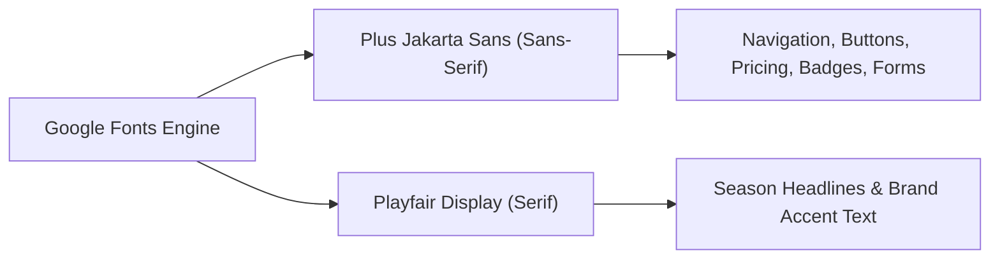

# 🎨 Design System & UI/UX Specifications — NISHU LUXE

**Brand Name:** NISHU LUXE (BY NITASHA)  
**Aesthetic Direction:** Editorial High-Converting E-Commerce (Zara, ASOS, and Loewe Flagship hybrid)  
**Target Region:** Pakistan & Global Luxury Market  

---

## 1. Design Philosophy

NISHU LUXE bridges **tactile editorial luxury** with **hard-selling commercial usability**:
1. **Clarity Over Clutter**: Large, crisp product photography with immediate access to prices, ratings, and actions.
2. **Tactile Micro-Interactions**: Color swatches that change labels on click, subtle image zoom on card hover, and heart animations for wishlisting.
3. **Urgency & Social Proof**: Live countdown timer badge, stock alerts (*"Only 14 Left"*), status badges (*BESTSELLER*, *-34% OFF*), and genuine customer ratings.
4. **Frictionless Mobile-First Layout**: Sticky navigation, slide-over cart drawer with swipe/ESC dismissal, and simplified checkout designed for mobile devices.

---

## 2. Color Palette & Design Tokens

```
/* Primary Core Colors */
--primary-dark:       #0F172A;   /* Deep Slate / Obsidian */
--primary-surface:    #1E293B;   /* Slate 800 for headers & footers */
--bg-main:            #F8FAFC;   /* Crisp Editorial Alabaster / Slate 50 */
--card-surface:       #FFFFFF;   /* Clean Pure White */

/* Accent & High-Conversion Tones */
--accent-amber:       #D97706;   /* Warm Brushed Gold / Amber 600 */
--accent-hover:       #B45309;   /* Deep Cognac Amber 700 */
--sale-red:           #DC2626;   /* Urgent Flash Sale Rose/Red */
--bestseller-green:   #059669;   /* Emerald 600 for Best Sellers & Free Shipping */
--border-subtle:      #E2E8F0;   /* Slate 200 Card Borders */
```

### Color Usage Matrix
| Role | Color Value | Applied To |
| :--- | :--- | :--- |
| **Canvas Background** | `#F8FAFC` (`bg-slate-50`) | Body background and neutral containers |
| **Card Surface** | `#FFFFFF` (`bg-white`) | Product cards, modals, cart drawer |
| **Header & Primary Action** | `#0F172A` (`bg-slate-900`) | Main CTA buttons, navbar logo, footer |
| **Conversion Accent** | `#D97706` (`text-amber-600`) | Prices, ratings stars, primary hero CTA |
| **Sale & Urgency** | `#DC2626` (`bg-rose-600`) | Flash sale banner, discount badges, wishlist fill |
| **Success & Shipping** | `#059669` (`bg-emerald-600`) | `BESTSELLER` tags, 100% Free Shipping progress bar |

---

## 3. Typography Hierarchy

NISHU LUXE pairs an ultra-clean geometric sans-serif for UI readability with an elegant serif for dramatic editorial moments.



### Typography Scale
| Element | Font Family | Size | Weight | Line Height | Example |
| :--- | :--- | :--- | :--- | :--- | :--- |
| **Display Heading** | Playfair Display | `3rem` – `3.75rem` (48–60px) | Extrabold (800) | `1.08` | `SEASON SALE: UP TO 40% OFF` |
| **Section Title** | Plus Jakarta Sans | `1.875rem` (30px) | Extrabold (800) | `1.2` | `Explore Handcrafted Bags` |
| **Product Title** | Plus Jakarta Sans | `1rem` (16px) | Bold (700) | `1.3` | `Classic Tuscan Leather Tote` |
| **Product Price** | Plus Jakarta Sans | `1.25rem` (20px) | Black (900) | `1.0` | `Rs. 8,900` |
| **Original Price** | Plus Jakarta Sans | `0.75rem` (12px) | Semibold (600) | `1.0` | `Rs. 13,500` (strikethrough) |
| **Body & Reviews** | Plus Jakarta Sans | `0.75rem` – `0.875rem` (12–14px) | Regular/Medium | `1.5` | Product description text |
| **Badges & Pills** | Plus Jakarta Sans | `0.625rem` (10px) | Extrabold (800) | `1.0` | `BESTSELLER`, `NEW`, `SALE` |

---

## 4. Component Anatomy

### 4.1 Product Card
```
+---------------------------------------------------+
| [-34% OFF] [Only 28 Left]             [❤️ Wishlist] |
|                                                   |
|             [ HIGH-RES BAG IMAGE ]                |
|             (Zooms 1.06x on hover)                |
|                                                   |
|             [ 👁️ Quick View Button ]               |
+---------------------------------------------------+
| TOTE BAGS                          Cognac Brown   |
| Classic Tuscan Leather Tote                       |
| ★ ★ ★ ★ ★  4.9 (184 reviews)                      |
| [o] [o] [o] (Interactive color swatches)          |
| Rs. 8,900  Rs. 13,500  [Save Rs. 4,600]           |
|                                                   |
| [        🛍️ ADD TO CART - FULL WIDTH        ]    |
+---------------------------------------------------+
```

### 4.2 Slide-Out Cart Drawer
* **Dimensions:** Fixed to right viewport, `100vw` on mobile, `max-w-md` (448px) on desktop.
* **Progress Meter:** Dynamic bar that transitions from Amber to Emerald upon reaching `Rs. 10,000`.
* **Quantity Controls:** Compact stepper buttons (`-` `Qty` `+`) with instantaneous subtotal recalculation.
* **Empty State:** Shows empty tote graphic, friendly message, and disables checkout CTA.

### 4.3 Modal Overlay & Dialogs
* **Backdrop:** `rgba(15, 23, 42, 0.60)` (`bg-slate-900/60`) with `backdrop-blur-sm`.
* **Container:** Rounded corners (`rounded-3xl`), border `border-slate-200`, smooth scale/opacity CSS transition.
* **Dismissal:** Accessible Close (`X`) button, backdrop click, or keyboard `Escape` press.

---

## 5. Micro-Interactions & Motion

| Interaction | Trigger | CSS / Animation Spec |
| :--- | :--- | :--- |
| **Card Lift** | Card Hover | `translateY(-4px)` with shadow `0 16px 32px -8px rgba(15, 23, 42, 0.12)` over `250ms cubic-bezier(0.16, 1, 0.3, 1)` |
| **Image Zoom** | Card Hover | `scale(1.06)` over `500ms cubic-bezier(0.16, 1, 0.3, 1)` |
| **Wishlist Heart** | Button Click | `scale(1.15)` pulse with color shift to `fill: #DC2626` |
| **Color Swatch** | Swatch Click | `box-shadow: 0 0 0 2px #FFF, 0 0 0 4px #0F172A` with label update |
| **Toast Alert** | Cart / Wishlist Action | Slide up from bottom right `translate-y-0` with auto-dismiss after `3200ms` |
| **Cart Drawer** | Cart Click | Smooth slide from right `translate-x-0` over `350ms cubic-bezier(0.16, 1, 0.3, 1)` |

---

## 6. Responsive Breakpoint Strategy

| Breakpoint | Screen Width | Layout Adjustments |
| :--- | :--- | :--- |
| **Mobile (`< 640px`)** | 320px – 639px | Single-column product grid, stacked hero banner, full-width cart drawer |
| **Tablet (`sm`, `md`)**| 640px – 1023px | 2-column product grid, 2x2 trust badge grid, compact live search |
| **Desktop (`lg`)**     | 1024px – 1279px| 3-column product grid, 12-column split hero with visual bag spotlight |
| **Large Desktop (`xl`)**| ≥ 1280px | 4-column product grid (12 bags visible in 3 clean rows), max container width 1280px |

---

## 7. Print Layout System (`@media print`)

When an order is confirmed, shoppers can print their official receipt. The print stylesheet automatically:
* Hides the navbar, hero banner, search bar, product grid, and footer.
* Centers the receipt card on clean white paper.
* Displays high-contrast black typography, customer shipping coordinates, and barcode lines.

