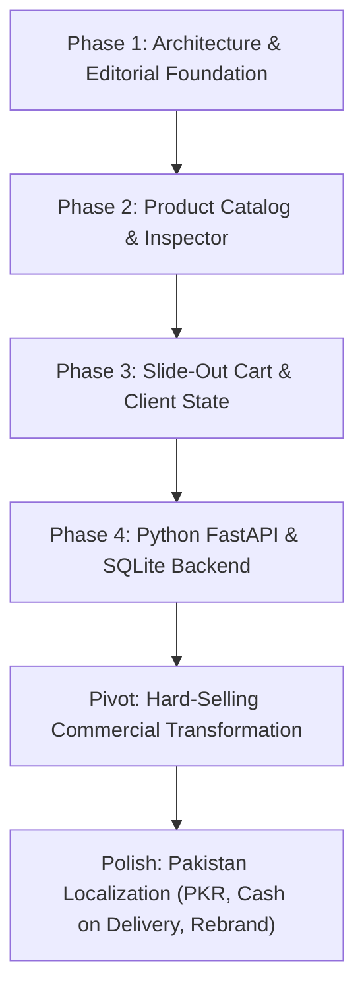

# 📋 Implementation Plan & Phased Tasks — NISHU LUXE

**Project:** NISHU LUXE (BY NITASHA)  
**Methodology:** Phased Vibe Coding & Iterative Full-Stack Refinement  
**Author:** Nitasha (Nishu)  
**Status:** Completed & Validated  

---

## 1. Project Phase Breakdown

---

## 2. Phase-by-Phase Task Matrix

### 🔷 Phase 1: Architectural Foundation & Initial Shell
* **Objective:** Establish the clean folder structure, asset pipeline, and baseline visual components.
* **Deliverables:**
  - [x] Created directory tree (`frontend/`, `frontend/css/`, `frontend/js/`, `backend/`).
  - [x] Configured Tailwind CSS via CDN with customized color tokens.
  - [x] Built sticky glassmorphic navigation header with brand emblem and cart trigger.
  - [x] Implemented split-screen editorial hero with typography and marquee banner.
  - [x] Configured custom scrollbars and base reset in `frontend/css/custom.css`.

---

### 🔷 Phase 2: Dynamic Catalog & Product Inspector
* **Objective:** Build the interactive product grid, filtering engine, and inspection modal.
* **Deliverables:**
  - [x] Created `frontend/js/catalog.js` containing initial 8 bag items.
  - [x] Built category filter pills (*All, Totes, Mini Bags, Limited Edition*).
  - [x] Created product cards with image hover zoom, price tags, and color swatch selector.
  - [x] Built Quick-View & Material Inspector Modal with tabbed details.

---

### 🔷 Phase 3: Slide-Out Cart Engine & Client-Side State
* **Objective:** Build full client-side cart management with `localStorage` persistence.
* **Deliverables:**
  - [x] Implemented `frontend/js/cart.js` with cart state methods (`addToCart`, `updateQuantity`, `removeFromCart`).
  - [x] Built slide-over cart drawer with backdrop overlay and smooth slide-in transition.
  - [x] Implemented quantity steppers (`+` / `-`) and subtotal calculations.
  - [x] Added dynamic free delivery progress bar.
  - [x] Built initial checkout modal collecting customer name, email, phone, and delivery address.

---

### 🔷 Phase 4: Full-Stack Integration (FastAPI + SQLite)
* **Objective:** Connect the frontend to a real Python backend API with SQLite database persistence.
* **Deliverables:**
  - [x] Created `backend/requirements.txt` (`fastapi`, `uvicorn`, `pydantic`).
  - [x] Built `backend/database.py` with SQLite WAL mode, schema DDL, and auto-seeding.
  - [x] Built `backend/models.py` with Pydantic schemas (`BagItem`, `OrderCreateRequest`, etc.).
  - [x] Built `backend/main.py` with CORS, endpoints (`GET /api/bags`, `POST /api/orders`), and FastAPI `StaticFiles` mounting.
  - [x] Configured automatic offline fallback in JavaScript in case backend server is paused.

---

### 🔷 Pivot: Hard-Selling Commercial Transformation
* **Objective:** Transition from an art magazine aesthetic to a hard-selling e-commerce bag store (like Zara, ASOS, and Amazon Luxury) for school evaluation.
* **Deliverables:**
  - [x] Replaced hero with a high-urgency **Flash Season Sale** banner and ticking countdown timer.
  - [x] Added 4 commercial trust badges (*100% Genuine Leather, Free Express Delivery, 30-Day Returns, Secure Checkout*).
  - [x] Expanded catalog to **12 commercial bags** across 5 distinct categories (*Totes, Crossbodies, Handbags, Backpacks, Duffels*).
  - [x] Added real-time live search in navbar input.
  - [x] Built **`+ Admin Demo`** modal to let teachers add custom products directly into the database during evaluation.
  - [x] Built printable order confirmation receipt with `@media print` styling.

---

### 🔷 Polish & Pakistan Localization (Final Presentation Pass)
* **Objective:** Rebrand to **NISHU LUXE by Nitasha**, convert all currencies to **Pakistani Rupees (PKR / Rs.)**, fix broken image links, and localize checkout.
* **Deliverables:**
  - [x] **Rebrand:** Changed website name and navbar logo to **NISHU LUXE** with subtitle **BY NITASHA**.
  - [x] **Browser Title:** Updated to `"NISHU LUXE | Premium Handbags & Totes in Pakistan by Nitasha"`.
  - [x] **Currency:** Converted all prices and calculations across HTML, JS, and SQLite to **`Rs.`** (realistic ranges: `Rs. 4,500` to `Rs. 16,500`).
  - [x] **Image Verification:** Verified all 12 Unsplash bag images and added `onerror="this.onerror=null;this.src='...';"` on every `` tag.
  - [x] **Promo Code:** Updated promo code to **`NISHU20`** (gives 20% discount; `BAG20` kept as alias).
  - [x] **Delivery Tiers:** Updated free shipping threshold to **`Rs. 10,000`**; orders below pay standard `Rs. 500` courier fee.
  - [x] **Empty Cart Guard:** Disabled checkout button and set shipping to `Rs. 0` when cart has 0 items.
  - [x] **Pakistan Checkout:** Added Pakistani phone format (`+92`), Pakistani city dropdown (Karachi, Lahore, Islamabad, etc.), and local payment options (Cash on Delivery, JazzCash/EasyPaisa, Bank Transfer).
  - [x] **Cache Reset:** Implemented `clearLegacyCaches()` to wipe old USD `localStorage` entries automatically.
  - [x] **Academic Notes:** Added student project notes and copyright acknowledging Nitasha (Nishu) in the footer.

---

## 3. Cumulative Verification Checklist

| Milestone | Expected Behavior | Status |
| :--- | :--- | :---: |
| **Catalog Seeding** | 12 bags seeded in `nishuluxe_store.db` with PKR prices | ✅ Pass |
| **Direct Web Serving** | `http://127.0.0.1:8000/` serves `frontend/index.html` with status 200 | ✅ Pass |
| **Live Search** | Instant filtering across name, category, and description | ✅ Pass |
| **Cart Quantity Engine** | Stepper buttons accurately update subtotal and item count | ✅ Pass |
| **Delivery Threshold** | `Rs. 500` below `Rs. 10,000`; `FREE` above `Rs. 10,000` | ✅ Pass |
| **Promo Code Calculation**| `NISHU20` deducts exactly 20% from cart subtotal | ✅ Pass |
| **Order Placement** | `POST /api/orders` returns reference `NL-2026-XXXX` and decrements stock | ✅ Pass |
| **Printable Receipt** | Generates customer invoice formatted cleanly for print | ✅ Pass |
| **Teacher Admin Demo** | Dynamically adds product to store grid and database | ✅ Pass |
| **Dual Hosting** | Works identically on FastAPI (port 8000) and Live Server (port 5500) | ✅ Pass |

